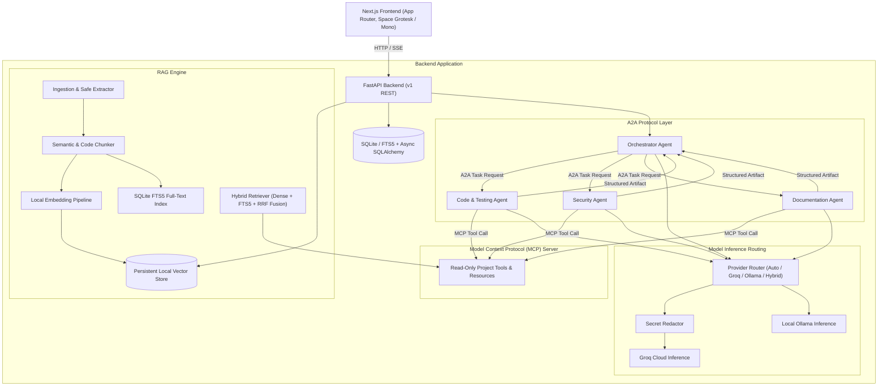

# M-ARCH Architecture Specification

## Overview

M-ARCH is a local-first, evidence-backed software project review platform designed to systematically inspect, evaluate, and verify software repositories using multi-agent reasoning, Retrieval-Augmented Generation (RAG), the Agent-to-Agent (A2A) protocol, and the Model Context Protocol (MCP).

## System Architecture

## Core Tenets

1. **Evidence-First Verification**: Every finding references specific chunk IDs, source line numbers, and exact supporting code excerpts.
2. **A2A & MCP Compliance**: Genuine Agent-to-Agent task distribution and Model Context Protocol tool execution.
3. **Safe Execution**: Never executes uploaded project code, scripts, or tests.
4. **Resilient Provider Modes**: Local Ollama support, Groq cloud acceleration, Auto fallback with exponential backoff, and Hybrid task routing.
5. **Data Protection**: Secrets are detected and redacted before any cloud LLM invocation.
